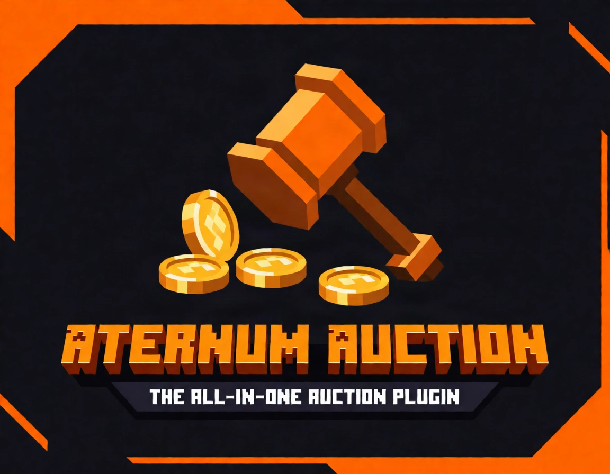
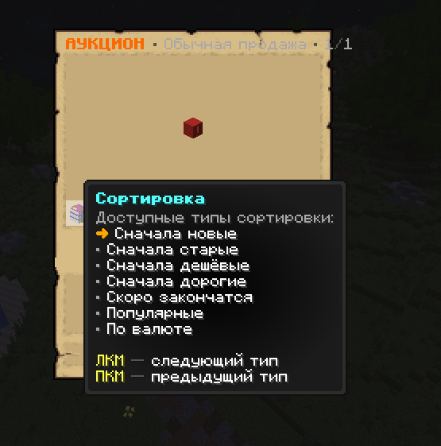
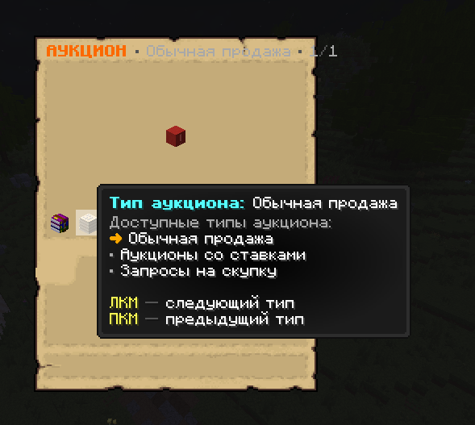
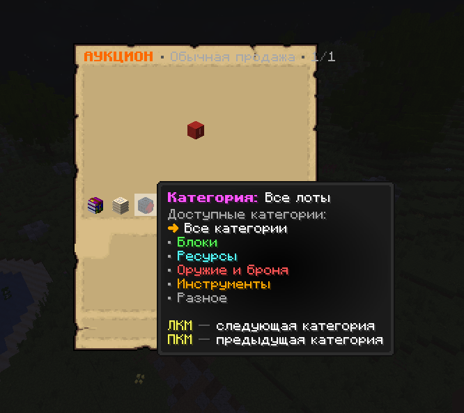
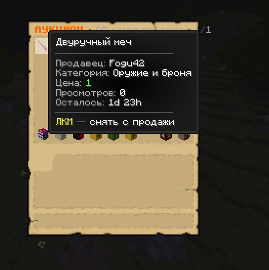
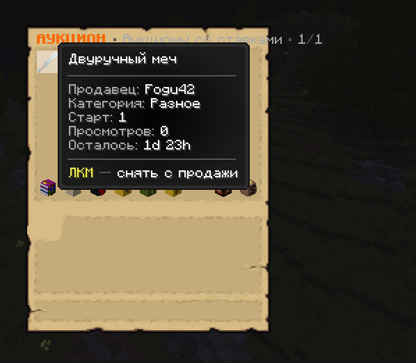
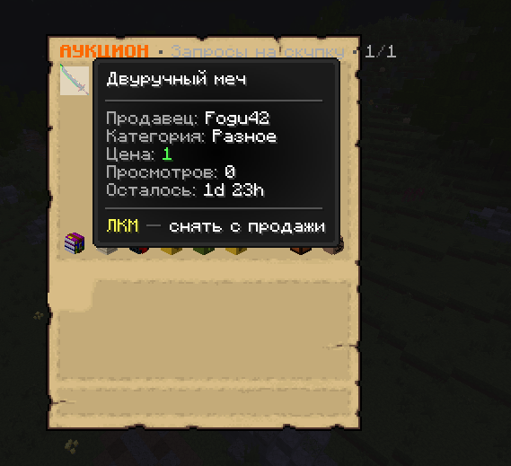
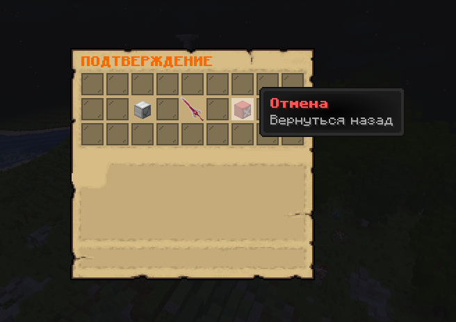
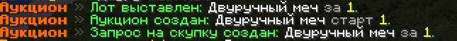

<p align="center">
  
</p>

<p align="center">
  
</p>

<h1 align="center">AternumAuction</h1>

<p align="center">
  Аукцион, который подстраивается под сервер, а не наоборот.
</p>

<p align="center">
  
  
  
  
  
</p>

---

## Что это

AternumAuction — многофункциональная торговая площадка для Bukkit, Spigot, Paper и Folia. Это не просто меню с продажей предметов, а гибкая система аукционов для серверов любого формата: от небольшого survival до большой сети с общей экономикой и MySQL.

Главная идея проекта — сервер не подстраивается под жёсткий интерфейс плагина. Каждый экран, слот, текст, кастомная голова и действие описываются в YAML. Администратор может менять внешний вид и логику меню без пересборки JAR.

Плагин объединяет несколько типов торговли, валют, хранилищ и интеграций в одной системе: покупки, ставки, запросы на скупку, история операций, лимиты, офлайн-выплаты, конвертация данных и мультисерверная синхронизация.

**Скачать:** готовый JAR лежит в [Releases](https://github.com/Fonisha/AternumAuction/releases).

---

## Почему AternumAuction

- **Три полноценных типа аукциона** в одном GUI: фиксированная цена, ставки и запросы на скупку.
- **Полная гибкость интерфейса**: YAML-меню, слоты `0–53`, кастомные головы, условия, наследование и действия без изменения кода.
- **Несколько экономик**: Vault, PlayerPoints, CoinsEngine, опыт, уровни и предметные валюты.
- **Готовность к большим серверам**: SQLite, MySQL, атомарное резервирование лотов и режим общей торговой площадки для сети.
- **Безопасные сделки**: проверки предметов и инвентаря, возвраты ставок, снятие своих лотов, очередь офлайн-выплат и защита от повторного использования лота.
- **Удобство для игроков**: категории, сортировка, «Мои лоты», история, просмотр шалкеров, истёкшие лоты и уведомления.
- **Расширяемость**: PlaceholderAPI, Discord-вебхуки, API, события, конвертеры данных и поддержка Folia.

## Что внутри

### Торговля

#### Фиксированная цена — BIN

Игрок выставляет предмет по конкретной цене, а покупатель сразу завершает сделку кнопкой «Купить». Поддерживаются стаки, частичное количество, налоги, лимиты и автоматическая передача предмета.

#### Аукцион со ставками — BID

Продавец задаёт стартовую цену и шаг ставки. Игроки перебивают друг друга, предыдущая ставка автоматически возвращается, а после завершения победитель получает предмет, а продавец — выплату.

#### Запрос на скупку — BUY_REQUEST

Игрок создаёт запрос на покупку нужного предмета. Другие игроки могут выполнить запрос полностью или частично, передав подходящий предмет и получив оплату. Средства резервируются, а остаток запроса сохраняется до полного выполнения или отмены.

Дополнительно доступны:

- шаг ставки, минимальная и максимальная цена;
- возврат предыдущей ставки при перебитии;
- автоматическое завершение аукциона и передача предмета победителю;
- выплата продавцу сразу или через очередь оффлайн-выплат;
- налог с продажи;
- продажа стака целиком или части;
- лимиты лотов: права + персональные бонусы из базы;
- проверка свободного места под предмет и стак;
- защита от продажи собственного лота;
- защита от повторной продажи одного и того же предмета;
- безопасное снятие лота с возвратом предмета.

### Валюты

Игрок выбирает валюту перед выставлением лота. Выбор запоминается.

| Валюта | Как подключить |
|---|---|
| Vault | любая Vault-экономика |
| RoyaleEconomy | через Vault |
| UltraEconomy | через Vault |
| KingdomsX | через Vault (банк) |
| PlayerPoints | встроенный адаптер |
| CoinsEngine | встроенный адаптер, id валюты в конфиге |
| Опыт | встроенная |
| Уровни | встроенная |
| Предметы | любой материал из конфига |

Если валюта не поддерживает оффлайн-игроков, выплата автоматически попадает в очередь и выдаётся при входе.

### Интерфейс

Все меню лежат в `plugins/AternumAuction/guis/`. Их настраивает только владелец сервера — игроки не могут менять кнопки и слоты в игре.

### Скрипты

Настройки и привязка скриптов к событиям находятся в отдельном файле `plugins/AternumAuction/scripts.yml` (не в `config.yml`). Готовые примеры — в `plugins/AternumAuction/scripts/examples.yml`. Свои `.yml` файлы можно просто положить в папку `scripts/` — они загружаются автоматически.

Пример включения комиссии:

```yaml
hooks:
  purchase:
    - commission_10_percent
```

После изменений выполните `/ah reload`. Скрипты могут считать комиссию от общей суммы покупки, учитывать предмет, модель, валюту, дату и час, отменять операцию, отправлять сообщения и писать в консоль. Переменные: `%price%`, `%total%`, `%amount%`, `%item%`, `%material%`, `%model%`, `%currency%`, `%type%`, `%seller%`, `%buyer%`, `%auction_id%`, `%hour%`, `%date%` и другие. Выражения поддерживают `+ - * / %`, сравнения, логику и функции (`min`, `max`, `round`, `contains`, `if` и др.). Скрипты не имеют доступа к Java API, файлам и сети.

### Скриншоты интерфейса

Актуальный интерфейс AternumAuction с переключаемыми сортировкой, типом аукциона и категориями:

| Экран | Пример |
|---|---|
| Сортировка |  |
| Тип аукциона |  |
| Категории |  |
| Обычная продажа |  |
| Аукцион со ставками |  |
| Запрос на скупку |  |
| Подтверждение действия |  |
| Уведомления в чате |  |

```text
main-gui.yml          главное меню
my-items-gui.yml      мои лоты
history-gui.yml       история
expired-gui.yml       истёкшие лоты и выплаты
categories-gui.yml    разделы
confirm-gui.yml       подтверждение покупки
currency-gui.yml      выбор валюты
shulker-gui.yml       просмотр содержимого
admin-gui.yml         админ-меню
```

В каждом файле настраиваются:

- размер меню (`rows`) и вместимость страницы (`page-size`);
- начало сетки лотов (`content-start`) и центрирование коротких страниц (`center-content`);
- слоты, материал, количество, название и lore кнопок;
- свечение, кастомная модель и головы-кнопки: `texture` (base64) или `head` (ник игрока);
- действия: `[MENU]`, `[PAGE]`, `[SORT]`, `[CLAIM]`, `[BUY]`, `[BID]`, `[PURGE]`, `[RELOAD]`, `[REFRESH]`, `[CMD]`, `[PLAYER]`, `[SOUND]`, `[MESSAGE]`, `[CLOSE]`, `[BACK]`;
- условия показа, например `conditions: ['%empty% == yes']` для заглушки пустого аукциона;
- наследование (`inherit: main-gui`), чтобы не дублировать кнопки.

После правки выполните `/ah reload`.

### Мультисервер

Включается в конфиге:

```yaml
server:
  id: 'survival-1'
  multi-server:
    enabled: true
    sync-interval-seconds: 20
    show-all-servers: false
```

С общей MySQL-базой лоты видны на всех серверах сети, а выплаты и предметы догоняют игрока на том сервере, где он зашёл. Продажа фиксируется атомарным удалением строки, поэтому один лот нельзя продать дважды с двух серверов.

### Просмотр шалкеров

ПКМ по лоту с шалкером открывает его содержимое. Предмет не нужно ставить в мир, содержимое не теряется. Работает и в истории, и в «Истёкших лотах».

### Сортировка и категории

Лоты можно разделять по категориям и сортировать по дате, цене, сроку окончания, популярности и валюте. В меню «Мои лоты» типы BIN, BID и BUY_REQUEST переключаются отдельно, поэтому собственные объявления не смешиваются в одну ленту.

### История

Отдельное меню с покупками, продажами, ставками, возвратами и выплатами. У администратора есть текстовый просмотр истории любого игрока.

### Конвертеры

`/ahadmin convert <plugin>` умеет читать YAML и SQLite-базы других аукционов. Схема читается через метаданные, поэтому небольшие различия в таблицах не ломают импорт.

Поддерживаются: `aternium`, `zauctionhouse`, `auctionhouse`, `axauctions`, `deluxeauctions`.

### Discord

Вебхуки на новые лоты, покупки, ставки и истечение. Отправка уходит в отдельный поток, таймауты ограничены, ошибки не спамят консоль.

### Folia и PlaceholderAPI

Планировщик сам определяет Folia и использует региональные шедулеры. PlaceholderAPI подключается автоматически, если установлен.

---

## Команды

| Команда | Описание |
|---|---|
| `/ah` | открыть аукцион |
| `/ah sell [цена] [кол-во]` | выставить предмет из руки |
| `/ah buy [цена] [кол-во]` | создать запрос на скупку предмета из руки |
| `/ah bid [цена] [кол-во]` | создать аукцион со ставками |
| `/ah view <игрок>` | лоты игрока |
| `/ah mine` | мои лоты |
| `/ah history` | история |
| `/ah expired` | забрать предметы и выплаты |
| `/ah categories` | открыть аукцион с переключателями категорий |
| `/ah limit` | текущий лимит |
| `/ah currency [id]` | выбрать валюту |
| `/ah reload` | перезагрузить плагин |

| Админ-команда | Описание |
|---|---|
| `/ahadmin menu` | админ-меню |
| `/ahadmin open <игрок>` | лоты игрока |
| `/ahadmin remove <uuid>` | удалить лот |
| `/ahadmin purge <дни>` | очистить старые лоты |
| `/ahadmin history <игрок>` | история игрока |
| `/ahadmin limit set/give/take/reset <игрок> [n]` | изменить лимит |
| `/ahadmin convert [plugin]` | конвертер |
| `/ahadmin reload` | перезагрузка |

---

## Права

```text
aternumauction.use
aternumauction.sell
aternumauction.bid
aternumauction.view
aternumauction.history
aternumauction.expired
aternumauction.currency.select
aternumauction.reload
aternumauction.admin
aternumauction.admin.open
aternumauction.admin.remove
aternumauction.admin.purge
aternumauction.admin.history
aternumauction.admin.limit
aternumauction.admin.convert
aternumauction.bypass.blacklist
aternumauction.bypass.limit
aternumauction.bypass.creative
aternumauction.limit.5
aternumauction.limit.10
aternumauction.limit.25
aternumauction.limit.50
aternumauction.limit.100
```

Итоговый лимит = максимальное право `aternumauction.limit.<n>` + бонус из базы.

---

## Плейсхолдеры

```text
%aternumauction_sell_limit%
%aternumauction_sell_count%
%aternumauction_expired_count%
%aternumauction_active_count%
%aternumauction_total_active%
%aternumauction_history_count%
%aternumauction_currency%
%aternumauction_server%
%aternumauction_version%
```

---

## Установка

1. Java 8+ и Spigot/Paper/Folia.
2. Vault и любая экономика (не обязательно, если используете опыт или предметы).
3. Положите `AternumAuction-1.0.1.jar` в `plugins/`.
4. Запустите сервер.
5. Настройте `config.yml`, `categories.yml`, `lang/*.yml` и `guis/*.yml`.
6. Перезагрузите: `/ah reload`.

При первом запуске создаются все языки, меню и конфиги. Ничего не нужно распаковывать вручную.

---

## Конфигурация

```yaml
settings:
  language: ru            # ru / en
  default-duration-hours: 48
  max-duration-hours: 168
  min-price: 1.0
  max-price: 1000000000.0
  bid-step: 1.0
  tax-percent: 0.0
  prevent-own-purchase: true
   prevent-duplicate-signatures: false

server:
  id: 'server-1'
  multi-server:
    enabled: false
    show-all-servers: false

storage:
  type: yaml              # yaml / sqlite / mysql
  sqlite-file: data.db
  mysql:
    host: localhost
    port: 3306
    database: aternum_auction
    username: root
    password: ''
    table-prefix: 'aternum_'

currencies:
  default: vault
  remember-selection: true
  selection-gui: true
```

Полный список — в `config.yml`, там же комментарии.

### MySQL

База должна существовать заранее, таблицы создаются сами. Префикс таблиц настраивается, поэтому одну базу можно делить с другими плагинами.

### Языки

`lang/ru.yml` и `lang/en.yml` содержат и сообщения, и тексты меню. Файлы меню ссылаются на них через `lang:menu.main.title` — переводить можно без правки кода и без пересборки.

---

## Сборка

```bash
mvn clean package
```

Готовый файл: `target/AternumAuction-1.0.1.jar`.

Проект компилируется под Java 8 и `spigot-api 1.13.2`, поэтому запускается и на старых, и на новых ядрах. SQLite и MySQL-драйверы уже внутри JAR.

---

## API

События:

```text
AuctionPreSellEvent
AuctionPostSellEvent
AuctionPrePurchaseEvent
AuctionPostPurchaseEvent
AuctionBidEvent
AuctionExpireEvent
AuctionClaimEvent
AuctionRemoveEvent
AuctionOpenEvent
```

Интерфейс: `AternumAuctionPlugin#getAPI()`.

---

## Проверка безопасности

В коде нет удалённых выключателей, скрытых запросов и выдачи прав. Единственное внешнее соединение — настраиваемый Discord-вебхук. Предметы сериализуются через Bukkit Object Streams, продажа подтверждается атомарно, деньги списываются после проверки инвентаря.

---

## English

AternumAuction is a configurable auction house for Bukkit, Spigot, Paper and Folia. Every menu is a YAML layout with custom head buttons, the server owner controls all slots and actions, and the plugin supports Vault, PlayerPoints, CoinsEngine, experience, levels and item currencies.

Highlights: BIN and bidding lots, automatic refunds, offline payouts, shulker preview, multi-server MySQL mode, converters, Discord webhooks, PlaceholderAPI and Folia scheduling.

Build with `mvn clean package`. The release jar is `AternumAuction-1.0.1.jar`.

---

## Автор и лицензия

Автор: [Fonisha](https://github.com/Fonisha)

Лицензия: [MIT](./LICENSE). Используйте, изменяйте и собирайте под свои задачи.

Иконки-головы для стандартных меню взяты из бесплатной коллекции [minecraft-heads.com](https://minecraft-heads.com).

<p align="center">
  
</p>

<p align="center">
  <a href="https://bstats.org/plugin/bukkit/AternumAuction/35506">
    
  </a>
</p>
